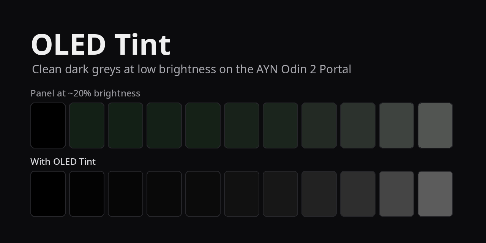

# OLED Tint

A Decky Loader plugin that fixes the AYN Odin 2 Portal's OLED at low
brightness: the green cast and the glowing near-black that make the bottom
half of the brightness range hard to use. Built on Armada OS (gamescope with
ReShade, HDR output on).

## What's wrong with the panel

Measured with a camera (a Sony A7 III, later an A7 IV, in a printed light hood, raw ratios,
black-frame subtracted):

- **At full brightness the panel is excellent.** Greys from 4 to 255 hold
  their colour within about 1%.
- **Between backlight levels ~52 and ~543 it isn't.** Below 52 and above 543
  it's clean again; the worst point is around 177 (about 20% on Steam's
  slider).
- **The cause is a pedestal per subpixel.** At low backlight each subpixel
  jumps from almost off at code 1 to a much too bright minimum at code 2,
  then barely rises. At backlight 177, code 2 gives 28% of code 32's light
  for green, 12% for blue and 9% for red; a normal 2.2 gamma would give
  0.2%. Green's pedestal being the highest is the green cast; all three
  being far too high is the glowing black.

## What the plugin does

- **Correction per brightness step and grey level.** 6 steps (52, 96, 177,
  310, 543, 4096) × 16 grey levels, each with tint (magenta↔green),
  red↔blue balance and brightness. Corrections keep a grey's luminance;
  between steps and levels everything is blended.
- **Two output paths.** ReShade (default): exact per-channel curves with 256
  samples and dithering, covering games and Steam's UI. gamescope's colour
  table (fallback): coarser, 17-point grid. One is active at a time.
- **Profiles.** Factory (no correction), plus named calibrations, e.g. one by
  eye and one by camera, switchable from the panel.
- **Calibration page** (full screen): sliders per level, curve chart,
  controller and touch navigation, before/after on Y.
- **Test pattern page** with brightness presets, for comparing devices.
- **Crush near-black:** optionally sends the darkest greys to true black.
- **Dither near-black (prototype):** rebuilds the darkest greys from the
  panel's real levels, mixed per pixel, so they reach their correct light
  instead of the pedestal. Needs camera tables for the panel.
- **Per-game effects** (e.g. VHS or CRT shaders) that share the ReShade slot.
- Pauses itself on external displays and when another colour effect is
  active.

### The panel

A status line on top says what the correction is doing right now, or why
not (off, Factory profile, clean range, external display, another colour
filter, off for this game, comparing). Below it, for every day: the switch,
brightness slider and step presets, profile, dither, then **Calibrate**,
**Test pattern** and **Compare** (5 s uncorrected), and **Off for <game>**
while a game runs. Two folded groups, remembered per device:

- **Shadows:** dither pattern (Still / Pair / Golden), shadow curve (Panel /
  Gamma 2.2), crush, and the date the panel tables were measured.
- **Demo:** Sweep (the brightness glides around the band, 50-1000, or the full range, 40-4096; the speed set as 15 s to 10 min per sweep around the band, the full range at that speed takes ~1.5x as long; 15 s on purpose faster than the correction) or Before / after (96, 177, 230, 310 in turn, corrected then uncorrected, 2-10 s each); optional stop after minutes or cycles.
- **Dimming** (main page): **Floor dimming** (the default) holds the backlight at 543, just above the bad band, and darkens the picture in the shader to the light the requested brightness would give (from the measured white curve, a flat gain, no dither); a brightness change inside the band becomes a request and the backlight stays at 543. Below the band the panel's own backlight takes over. **Dither correction** (Advanced, experimental) keeps the real backlight and corrects the band with per-step curves and dithering.
- **Advanced:** the info overlay (lines in Steam's performance overlay: brightness against the maximum, what the correction does and why, dither tables, lift, crush), ReShade on/off, Steam's menus, dither in Steam's UI, random
  brightness, profiles (New / Copy / Rename / Delete;
  Factory stays read-only), export and import.

## Install

On Armada with Decky Loader: build (`pnpm install && pnpm build`), then
`scripts/deploy.sh`. The first deploy needs the plugin folder created once
with sudo (see the script). Or install a packaged zip through Decky's
developer settings: **Install plugin from ZIP**.

**Lite package** (`scripts/package-lite.sh`): the plugin with a bundled
profile, with the panel's groups folded. For sharing a calibration with
other Portals.

## Calibrating with a camera

[oled-measure](https://github.com/murdii34/odin2-portal-oled-measure) (separate repository) drives a Sony camera over USB
(gphoto2, PC Remote mode), shows full-screen patches through Steam's debug
port and writes results into this plugin's settings: a reference at full
brightness, single-subpixel floor runs, and a closed loop per step that
corrects colour until the camera can't tell it from the reference. See its
README.

## Notes for development

- Plugins run under FEX (x86 emulation) on Armada; heavy work goes to a
  native helper (`main.py --helper`, started via the booted ostree's python).
- gamescope picks up a new ReShade effect anywhere from 0.2 to ~30 s after
  it's set, and needs at least one uniform in the effect (freedreno).
- Tests: `python3 -m unittest discover -s tests`.
